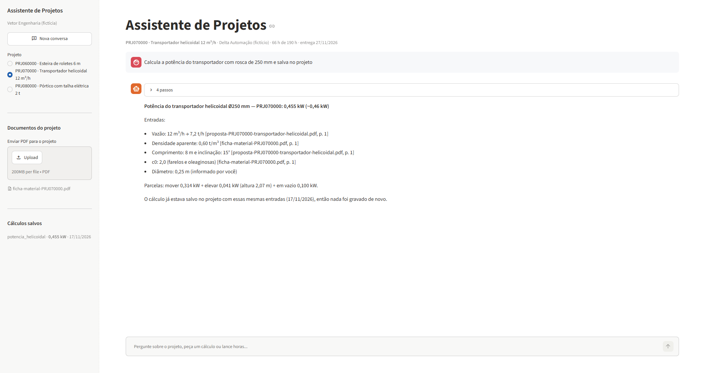
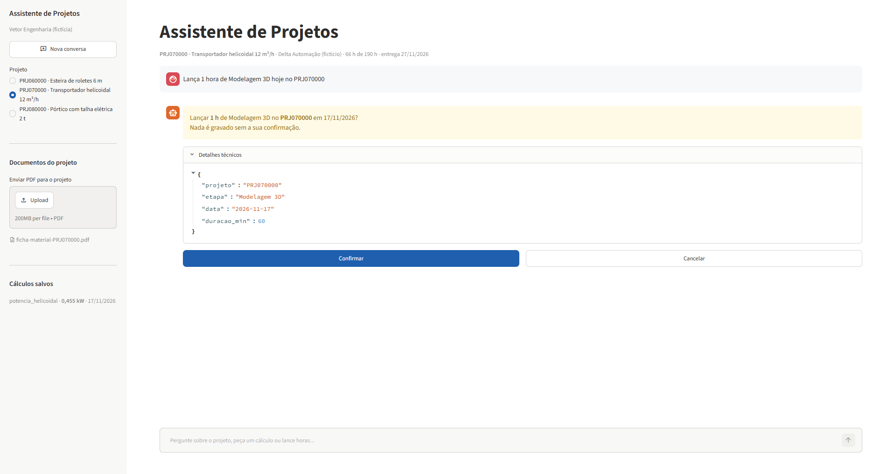
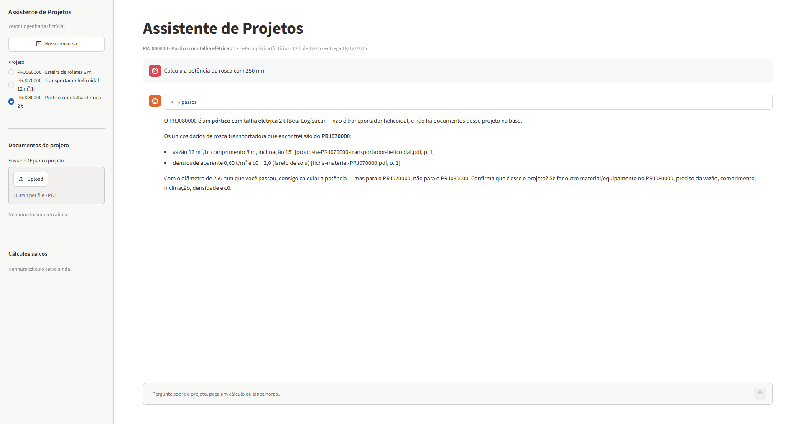
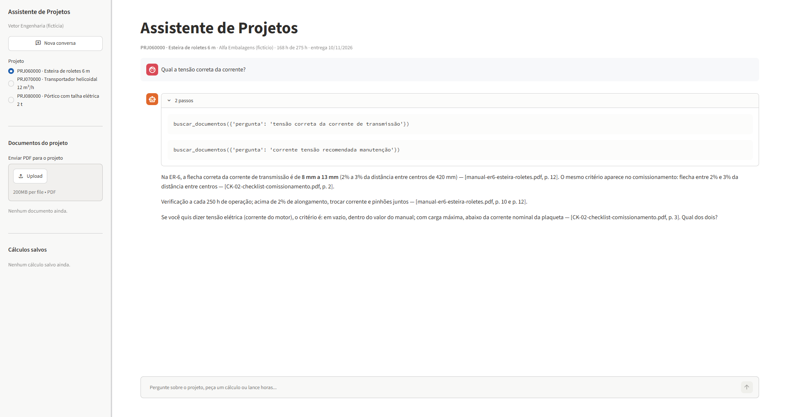
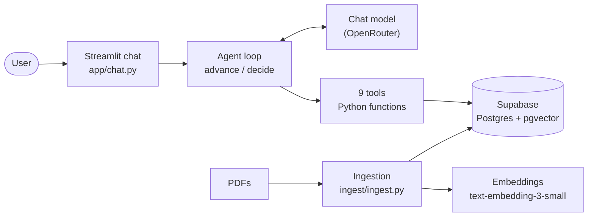

# Project Assistant — RAG + tool-using agent for an engineering office

🇧🇷 [Leia em português](README.pt-BR.md)

An AI assistant for a mechanical engineering office (conveyors, hoists, industrial equipment). It answers questions from the company's PDFs **with page citations**, reads and updates project data, and runs engineering calculations in which **every input is traced back to the document it came from**. Nothing is written to the database without the user's confirmation.

> All companies, people and numbers are **fictional** ("Vetor Engenharia"). This is a portfolio project, built to be integrated later into a real project-hours dashboard used by a mechanical engineer.



## What it does

- **Answers from documents, with sources.** Manuals, procedures, checklists and proposals are searched semantically, and every claim is cited as `[file.pdf, p. X]`. If the answer is not in the documents, it says so.
- **Knows the projects.** Hours logged vs. planned, progress and deadlines, read from the database. Business-day math (weekends and Brazilian holidays) is done by code, never by the model.
- **Calculates with traceable inputs.** Example above: screw conveyor power (DIN method). Flow, length and inclination come from the commercial proposal, material density and resistance coefficient from the client's datasheet, and the screw diameter from the user. The result is stored with its inputs **and the source of each one**.
- **Asks before writing.** Logging hours, saving a document to a project or saving a calculation shows a plain-language confirmation first.
- **Learns new documents.** A PDF uploaded to a project becomes searchable right away; if a file with the same name changes, it is re-indexed.
- **Doesn't make things up.** Asked to calculate a screw conveyor for a project that is actually a hoist with no documents, it stops and asks instead of reusing another project's data.

| Confirmation before any write | Not making things up |
|---|---|
|  |  |



## How it works



1. **Ingestion** reads each PDF page, removes repeated headers and footers, splits the text into chunks of whole sentences, generates embeddings and stores them in Postgres with `pgvector`.
2. **The agent loop** sends the conversation plus a catalog of tools to the model. The model decides which tools to call; the code runs them and sends the results back, until the model writes the final answer.
3. **Write tools pause the loop.** When the model asks for a tool that changes data, the loop stops and the UI shows *Confirm / Cancel*. The click resumes the loop from where it stopped.

| Tool | What it does | Writes? |
|---|---|---|
| `buscar_documentos` | Semantic search over the PDFs, returns chunks with file and page | |
| `ver_projeto` | Project data, with hours summed from the time entries | |
| `calcular_dias_uteis` | Adds business days to a date | |
| `dias_uteis_entre` | Counts business days between two dates (delay / slack) | |
| `potencia_helicoidal` | Screw conveyor power: move + lift + no-load (kW) | |
| `ver_calculos` | Lists calculations saved in a project | |
| `lancar_horas` | Logs hours worked on a project | ✔ |
| `salvar_documento_projeto` | Indexes a PDF inside a project | ✔ |
| `salvar_calculo` | Saves a calculation with inputs, result and sources | ✔ |

## Engineering decisions

These came from testing the agent and fixing what went wrong:

- **The model never does math.** In an early test the model computed a project delay "in its head" and answered 10 business days instead of 9. Writing "never calculate dates yourself" in the prompt was not enough, because there was no tool for that question. Adding `dias_uteis_entre` fixed it. Rule: if an answer needs a number, a tool must produce it.
- **Saved results are recomputed.** `salvar_calculo` receives the *inputs*, not the result, and runs the calculation again in Python before saving. What goes to the database always comes from code, never from the model copying numbers.
- **A pausable agent loop.** The loop was split into `avancar()` (run until a final answer or a write request) and `decidir()` (resume after the click). This is what makes button confirmations possible in a web UI, where there is no `input()`. It also handles several tool calls in one turn, with writes and reads mixed.
- **Chunks of whole sentences.** Fixed 200-word windows cut sentences in half, and the second half of a procedure was lost from the search results. Chunks are now built from whole sentences, and each one repeats the last sentence of the previous chunk as overlap.
- **Citations by file and page.** `[1]`, `[2]` stop making sense when the agent searches more than once in the same answer, so citations use the file name and page.
- **Document fingerprints.** Each PDF is stored with its SHA-256 hash. Same name and same content: nothing happens. Same name, new content: it is re-indexed. The PDF is parsed and embedded *before* the old version is deleted, so a failure halfway never leaves the database without the document.
- **No duplicate calculations.** Saving the same calculation (same project, type and inputs) twice is refused.
- **Locked-down database.** Row Level Security is enabled with no policies, so the data is only reachable with the server-side key.

## Tech stack

Python · Streamlit · Supabase (Postgres + pgvector) · OpenRouter (OpenAI-compatible API) · `text-embedding-3-small` for embeddings · DeepSeek V4.1 Flash as the chat model · pypdf

## Running it locally

1. **Install**
   ```bash
   git clone https://github.com/NatanRosler/project-assistant-rag
   cd project-assistant-rag
   pip install -r requirements.txt
   ```
2. **Database.** Create a Supabase project and run the files in `supabase/` **in order** (`001` to `005`) in the SQL Editor. `002` also creates three fictional projects with time entries.
3. **Keys.** Copy `.env.example` to `.env` and fill in:
   - `SUPABASE_URL` and `SUPABASE_SERVICE_KEY` (the **secret** key; it stays on your machine, never in a browser)
   - `OPENROUTER_API_KEY`
   - `MODELO_CHAT`: the OpenRouter id of a chat model that supports tool calling
4. **Index the base documents** (the PDFs in `doc/pdfs/`):
   ```bash
   python ingest/ingest.py
   ```
5. **Open the app:**
   ```bash
   python -m streamlit run app/chat.py
   ```
6. **Try it:** select PRJ070000, upload `doc/novos/ficha-material-PRJ070000.pdf` from the sidebar, then ask *"Calcula a potência do transportador com rosca de 250 mm e salva no projeto"*.

The same agent also runs in the terminal: `python -m experimentos.agente`.

## Project structure

```
app/chat.py             Streamlit interface: chat, confirmations, sidebar
experimentos/agente.py  Tools, tool catalog, prompt and the agent loop
ingest/ingest.py        PDF ingestion: cleaning, sentence chunks, embeddings, hashes
supabase/001-005        Database schema, in the order they must run
doc/pdfs/               Fictional company documents (manual, procedure, checklist, proposal, standard)
doc/novos/              Documents that arrive later, saved into a project through the app
```

The other files in `ingest/` and `experimentos/` are earlier steps of the project (first embedding test, search-only answers, first tool-calling test), kept as a record of how it was built.

## Limitations and next steps

- Search covers all documents; the next step is filtering by the selected project.
- The power formula is a simplified method and must be validated by the engineer before real use.
- Single user, no login in the interface.
- Next: plug the assistant into the engineer's project dashboard (React), add the calculators he uses most (bolted and welded connections) and keep a separate conversation per project.

## Author

**Natã Rösler**, Computer Engineering student at UNIVALI and web systems developer · [LinkedIn](https://www.linkedin.com/in/nat%C3%A3-r%C3%B6sler-1616143b0/)
