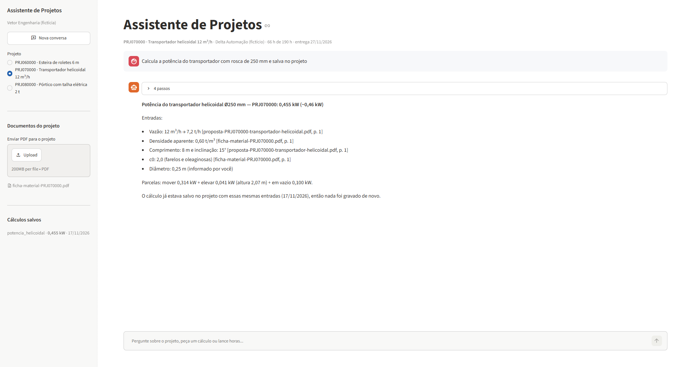
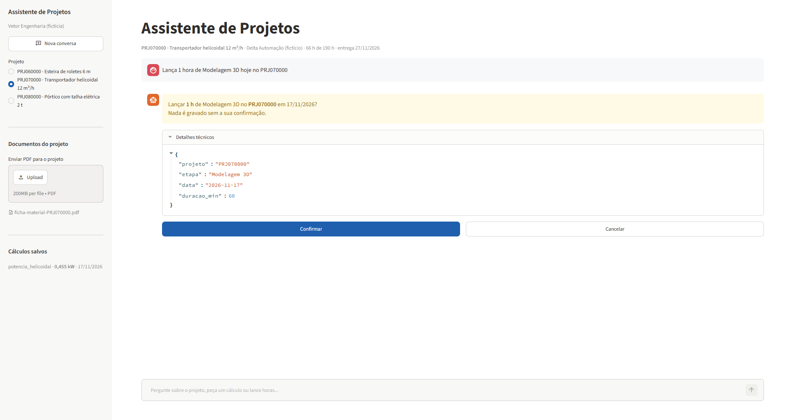
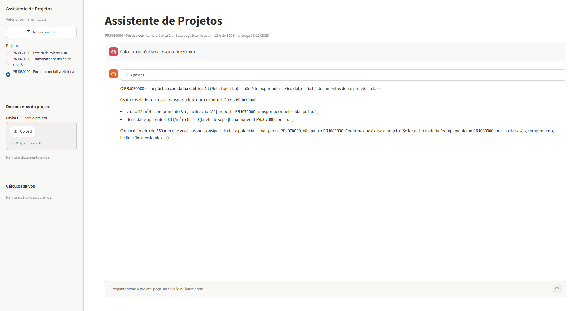
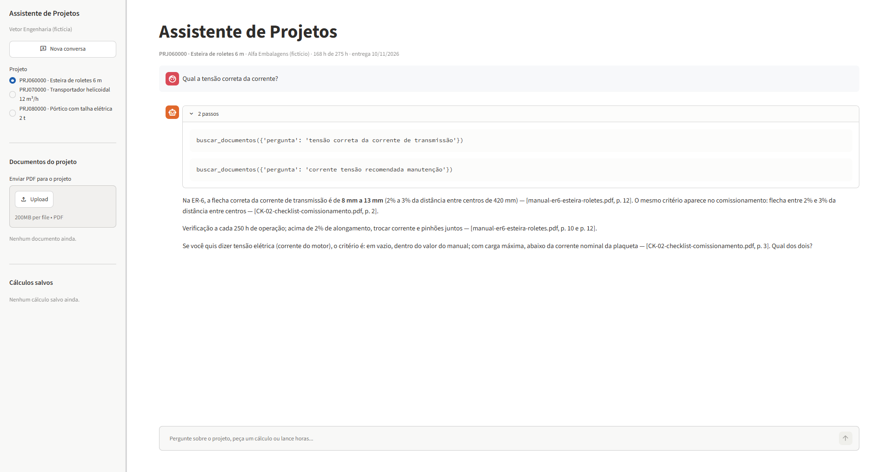
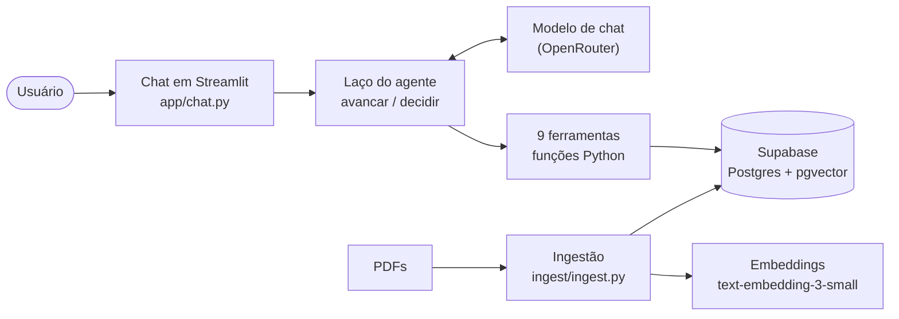

# Assistente de Projetos — RAG + agente com ferramentas para um escritório de engenharia

🇺🇸 [Read in English](README.md)

Um assistente de IA para um escritório de engenharia mecânica (esteiras, transportadores, içamento). Ele responde perguntas a partir dos PDFs da empresa **citando a página**, lê e atualiza os dados dos projetos e faz cálculos de engenharia em que **cada dado de entrada é rastreado até o documento de onde veio**. Nada é gravado no banco sem a confirmação do usuário.

> Todas as empresas, pessoas e números são **fictícios** ("Vetor Engenharia"). É um projeto de portfólio, feito para depois ser integrado a um painel de horas de projeto usado por um engenheiro mecânico de verdade.



## O que ele faz

- **Responde a partir dos documentos, com fonte.** Manuais, procedimentos, checklists e propostas são pesquisados por significado, e cada informação é citada como `[arquivo.pdf, p. X]`. Se a resposta não está nos documentos, ele diz isso.
- **Conhece os projetos.** Horas lançadas e previstas, andamento e prazos, lidos do banco. As contas de dias úteis (fins de semana e feriados nacionais) são feitas pelo código, nunca pelo modelo.
- **Calcula com entradas rastreáveis.** No exemplo acima: potência de um transportador helicoidal (método DIN). Vazão, comprimento e inclinação vêm da proposta comercial; densidade do material e coeficiente de resistência, da ficha enviada pelo cliente; o diâmetro da rosca, do usuário. O resultado é salvo com as entradas **e a origem de cada uma**.
- **Pergunta antes de gravar.** Lançar horas, salvar um documento num projeto ou salvar um cálculo mostra antes uma confirmação em linguagem simples.
- **Aprende documentos novos.** Um PDF enviado para um projeto passa a ser pesquisável na hora; se um arquivo com o mesmo nome mudar, ele é reindexado.
- **Não inventa.** Quando pedem o cálculo de uma rosca num projeto que na verdade é um pórtico sem documentos, ele para e pergunta, em vez de reaproveitar os dados de outro projeto.

| Confirmação antes de gravar | Não inventar |
|---|---|
|  |  |



## Como funciona



1. **A ingestão** lê cada página do PDF, tira os cabeçalhos e rodapés repetidos, divide o texto em trechos de frases inteiras, gera os embeddings e guarda tudo no Postgres com `pgvector`.
2. **O laço do agente** manda a conversa e um catálogo de ferramentas para o modelo. O modelo decide quais ferramentas chamar; o código executa e devolve os resultados, até o modelo escrever a resposta final.
3. **Ferramentas que gravam pausam o laço.** Quando o modelo pede uma ferramenta que altera dados, o laço para e a tela mostra *Confirmar / Cancelar*. O clique faz o laço continuar de onde parou.

| Ferramenta | O que faz | Grava? |
|---|---|---|
| `buscar_documentos` | Busca por significado nos PDFs, devolve trechos com arquivo e página | |
| `ver_projeto` | Dados do projeto, com as horas somadas a partir dos lançamentos | |
| `calcular_dias_uteis` | Soma dias úteis a uma data | |
| `dias_uteis_entre` | Conta os dias úteis entre duas datas (atraso / folga) | |
| `potencia_helicoidal` | Potência de transportador helicoidal: mover + elevar + em vazio (kW) | |
| `ver_calculos` | Lista os cálculos salvos num projeto | |
| `lancar_horas` | Lança horas trabalhadas num projeto | ✔ |
| `salvar_documento_projeto` | Indexa um PDF dentro de um projeto | ✔ |
| `salvar_calculo` | Salva um cálculo com entradas, resultado e fontes | ✔ |

## Decisões de engenharia

Elas surgiram testando o agente e corrigindo o que dava errado:

- **O modelo nunca faz conta.** Num dos primeiros testes, o modelo calculou o atraso de um projeto "de cabeça" e respondeu 10 dias úteis em vez de 9. Escrever "nunca calcule datas de cabeça" nas instruções não bastou, porque não existia ferramenta para aquela pergunta. Criar a `dias_uteis_entre` resolveu. A regra: se a resposta precisa de um número, uma ferramenta tem que produzi-lo.
- **O resultado salvo é recalculado.** A `salvar_calculo` recebe as *entradas*, não o resultado, e refaz a conta em Python antes de gravar. O que vai para o banco sempre sai do código, nunca do modelo copiando números.
- **Um laço de agente "pausável".** O laço foi dividido em `avancar()` (roda até a resposta final ou até um pedido de gravação) e `decidir()` (continua depois do clique). É isso que permite confirmar com botões numa página web, onde não existe `input()`. Ele também trata várias ferramentas pedidas de uma vez, com leituras e gravações misturadas.
- **Trechos de frases inteiras.** Cortar a cada 200 palavras exatas partia frases no meio, e a segunda metade de um procedimento sumia dos resultados da busca. Agora os trechos são montados com frases inteiras, e cada um repete a última frase do anterior como sobreposição.
- **Citação por arquivo e página.** `[1]`, `[2]` deixam de fazer sentido quando o agente busca mais de uma vez na mesma resposta, então a citação usa o nome do arquivo e a página.
- **Impressão digital dos documentos.** Cada PDF é guardado com o seu hash SHA-256. Mesmo nome e mesmo conteúdo: nada acontece. Mesmo nome e conteúdo novo: é reindexado. O PDF é lido e vetorizado *antes* de a versão antiga ser apagada, então uma falha no meio nunca deixa o banco sem o documento.
- **Sem cálculos duplicados.** Salvar duas vezes o mesmo cálculo (mesmo projeto, tipo e entradas) é recusado.
- **Banco fechado.** O Row Level Security está ligado e sem nenhuma regra, então os dados só são acessíveis com a chave do servidor.

## Tecnologias

Python · Streamlit · Supabase (Postgres + pgvector) · OpenRouter (API compatível com a da OpenAI) · `text-embedding-3-small` para os embeddings · DeepSeek V4.1 Flash como modelo de chat · pypdf

## Como rodar

1. **Instalar**
   ```bash
   git clone https://github.com/NatanRosler/project-assistant-rag
   cd project-assistant-rag
   pip install -r requirements.txt
   ```
2. **Banco.** Crie um projeto no Supabase e rode os arquivos de `supabase/` **na ordem** (`001` a `005`) no SQL Editor. O `002` já cria três projetos fictícios com lançamentos de horas.
3. **Chaves.** Copie o `.env.example` para `.env` e preencha:
   - `SUPABASE_URL` e `SUPABASE_SERVICE_KEY` (a chave **secreta**; ela fica no seu computador, nunca num navegador)
   - `OPENROUTER_API_KEY`
   - `MODELO_CHAT`: o identificador, no OpenRouter, de um modelo de chat que aceite ferramentas
4. **Indexar os documentos base** (os PDFs de `doc/pdfs/`):
   ```bash
   python ingest/ingest.py
   ```
5. **Abrir a tela:**
   ```bash
   python -m streamlit run app/chat.py
   ```
6. **Testar:** selecione o PRJ070000, envie o `doc/novos/ficha-material-PRJ070000.pdf` pela lateral e pergunte *"Calcula a potência do transportador com rosca de 250 mm e salva no projeto"*.

O mesmo agente também roda no terminal: `python -m experimentos.agente`.

## Estrutura

```
app/chat.py             Interface em Streamlit: chat, confirmações, lateral
experimentos/agente.py  Ferramentas, catálogo, instruções e o laço do agente
ingest/ingest.py        Ingestão dos PDFs: limpeza, trechos por frases, embeddings, hashes
supabase/001-005        Estrutura do banco, na ordem em que deve ser rodada
doc/pdfs/               Documentos fictícios da empresa (manual, procedimento, checklist, proposta, padrão)
doc/novos/              Documentos que chegam depois e são salvos num projeto pela tela
```

Os outros arquivos de `ingest/` e `experimentos/` são etapas anteriores do projeto (primeiro teste de embeddings, respostas só com busca, primeiro teste com ferramentas), mantidos como registro de como ele foi construído.

## Limitações e próximos passos

- A busca procura em todos os documentos; o próximo passo é filtrar pelo projeto selecionado.
- A fórmula de potência é um método simplificado e precisa ser validada pelo engenheiro antes do uso real.
- Um único usuário, sem login na tela.
- Próximos passos: levar o assistente para o painel de projetos do engenheiro (React), acrescentar as calculadoras que ele mais usa (ligações parafusadas e soldadas) e manter uma conversa separada por projeto.

## Autor

**Natã Rösler**, estudante de Engenharia da Computação na UNIVALI e desenvolvedor de sistemas web · [LinkedIn](https://www.linkedin.com/in/nat%C3%A3-r%C3%B6sler-1616143b0/)
